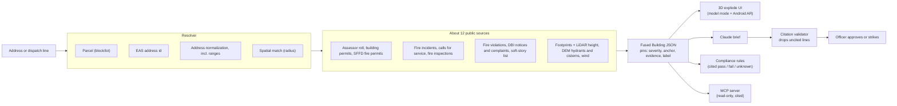

# FireSight

**Size-up starts before the wheels stop.**

FireSight turns any San Francisco address into a cited, floor-by-floor 3D pre-plan for the officer on a responding engine.


> **Not for operational use.** FireSight is an independent prototype built by a team of four in one day at a San Francisco hackathon. It is not affiliated with, endorsed by or reviewed by SFFD or any public agency. The example call in the preview is simulated. Your eyes, your 360 and your department's pre-plan come first.

**Try the preview:** [hosted field preview](https://claude.ai/artifact/58t4TUvtTNziCrPDz2jgGX) · or open [`docs/field-preview.html`](docs/field-preview.html) locally in any browser (no install, no server).

**Firefighters, we want your take.** The preview ends with a 3-minute form, and every question is optional. Fill in what you like, tap **Copy my answers**, and paste them into a reply to whoever sent you the link. Nothing is sent anywhere automatically, and your draft stays in your browser. We most want to hear what is useful, what is missing, and what could be dangerous on a real call.

---

## Contents

- [Why](#why)
- [What it does](#what-it-does)
- [Example: 400 Duboce Ave](#example-400-duboce-ave)
- [How it works](#how-it-works)
- [The Building JSON contract](#the-building-json-contract)
- [What it knows, and what it doesn't](#what-it-knows-and-what-it-doesnt)
- [Code checks, with citations](#code-checks-with-citations)
- [Responsible data](#responsible-data)
- [Data sources and licenses](#data-sources-and-licenses)
- [Quickstart (coming as the build lands)](#quickstart-coming-as-the-build-lands)
- [Repo layout](#repo-layout)
- [Status and roadmap](#status-and-roadmap)
- [Team](#team)
- [Acknowledgements](#acknowledgements)
- [License](#license)

## Why

A company officer often has a few minutes in the rig to size up a building they have never been inside. Much of what changes tactics is already public: construction type, soft-story status, rooftop solar, unit counts, open fire code violations and past fires. It is spread across many city systems that nobody can search on the way to a call, and hand-built pre-plans take time and go stale.

In the fire service's own words (published sources, not our interviews):

> "We definitely would have looked at things a lot different. If we had known that the roof structure in that building was of lightweight construction."
> Ed Smith, North Perth Fire Department, on the 2011 Listowel collapse that killed two firefighters. CTV News, Aug 19 2016.

> "The fire department had not conducted a formal pre-incident inspection of this facility nor developed a formal pre-incident plan."
> NIOSH Fire Fighter Fatality Investigation F2021-10, Spring Valley NY. Dec 2024.

## What it does

1. **Address in.** Dispatch gives an address. FireSight matches every city record to the one building, even when the records use different addresses for it.
2. **Building in 3D.** The real footprint and measured height, split into floors. One tap separates the floors so each hazard shows where it sits.
3. **Facts pinned in place.** Construction, units per floor, soft-story status, rooftop solar, violations, past fires, the nearest hydrant and cistern. Each pin is dated and sourced.
4. **Gaps said out loud.** Stairs, standpipes and anything with no public record show as unverifiable. FireSight does not guess.
5. **Officer approves.** The officer approves or strikes each line of the size-up summary before it goes to the crew. Nothing goes out without a human.

Every fact carries one of three labels:

| Label | Meaning |
|---|---|
| **VERIFIED** | A public record says it. The pin shows which one. |
| **UNVERIFIABLE** | No public record covers it. |
| **CONFLICT** | Records disagree. FireSight shows both. |

## Example: 400 Duboce Ave

What the public record shows for one real building (from the field preview):

| Fact | Label | Source | As of |
|---|---|---|---|
| 4 stories, wood frame (Type V), apartments | VERIFIED | SF building permits; property tax roll | 2024 permit; 2025 roll |
| Residential units: 78 or 79 | CONFLICT | Tax roll says 78; permits say 79 | 2025 / 2024 |
| Listed as "50 CHURCH ST" in the tax roll and "400 DUBOCE AVE" in permits | MATCHED | Resolved on parcel 0874/003 | 2025 |
| Soft-story building, retrofit work complete | VERIFIED | SF soft-story program list | Oct 2026 |
| Solar hot-water panels on roof (not PV) | VERIFIED | Building permit | 2019 |
| Fire alarm upgraded to NFPA 72 (2022) | VERIFIED | Building permit | 2024 |
| Sprinkler activation due to malfunction | VERIFIED | SFFD fire incidents | 2023 |
| Building fire at this address | VERIFIED | SFFD fire incidents | 2003 |
| Hydrant about 27 m away; cistern about 156 m | VERIFIED | SF Dept. of Emergency Management map layer | 2018 snapshot |
| Annual R-2 fire inspection on record | VERIFIED | SFFD inspections, completed 2026-08-04 | 2026 |
| Stair and standpipe locations | UNVERIFIABLE | No public floor plans | n/a |

The name mismatch is the reason identity resolution exists: search permits for "50 Church St" and you miss the building's whole permit history.

## How it works



**Resolver.** Each dataset joins to the building by the strongest key it has: parcel block/lot or EAS address id (exact), a normalized address including ranges like "1018 - 1024 Mission St" (high or medium), or a spatial radius (low). Every join records its method, its confidence and how many records matched, so you can see how sure FireSight is that a record belongs to this building.

**Fusion.** Records become pins. A 3-digit unit number in a permit ("unit 311") anchors a pin to that floor; anything without a floor goes to the building, roof or ground. Permits often disagree on stories or units, so FireSight takes the most common value. When two sources disagree (the tax roll says 78 units, permits say 79), the pin is labelled CONFLICT and shows both.

**3D.** The footprint is extruded floor by floor in three.js. "Explode" lifts the floors apart and flies each pin to its anchor, most severe first. A dispatch line that names a unit focuses that floor.

**Brief.** Claude rephrases only fused, cited facts into a short size-up. A validator drops any line that does not cite a pin in the building. The officer approves or strikes every line, and each struck line becomes a test case.

**MCP.** A read-only Model Context Protocol server lets other agents ask for a building's size-up and get typed, cited answers. It cannot change anything.

## The Building JSON contract

One file per building, keyed by parcel (for example `sf-0874003`). The full types live in `shared/building.ts` (in progress). In short:

| Field | What it holds |
|---|---|
| `footprint`, `heightM`, `floors`, `floorHeightM` | Geometry in local meters; floor height is height divided by floors |
| `pins[]` | Every fact on the model (below) |
| `conflicts[]` | Pairs of records that disagree, with a one-line summary |
| `unknowns[]` | Facts asked for that have no public record |
| `layers[]` | Per dataset: `ok`, `no_records` or `fetch_failed`, with an as-of date |
| `resolution` | Parcel, EAS id, address aliases, and every join with method, confidence and record count |
| `fallback` | A precomputed brief and answers for when the network is slow or gone |

Each pin:

| Field | Values |
|---|---|
| `severity` | `danger`, `caution`, `info` |
| `anchor` | `building`, `floor` (with a floor number), `roof`, or `ground` (with bearing and distance) |
| `label` | 3 to 6 words for the chip, plus a one-sentence `detail` |
| `claim` | `verified`, `unverifiable`, `conflict` |
| `evidence[]` | Source, dataset id, record id, URL, as-of date and the rule that placed it (for example "unit 311 -> floor 3") |
| `origin` | `public`, `dispatch`, `crew`, `department` |
| `stale` | True when the record is more than 5 years old |

## What it knows, and what it doesn't

**It knows** what San Francisco's public records say about a building: construction, stories, units, use, soft-story status, permits (solar, alarm, sprinkler, structural work), SFFD fire permits, violations and notices, past incidents, inspections, nearby hydrants and cisterns, and current wind. Each with a source and a date.

**Its data has limits:**

- Building heights come from 2010 LiDAR scans; footprints are from September 2023.
- Hydrant and cistern positions are from a 2018 city snapshot.
- City fire incident data runs about 4 weeks behind, and calls for service about 8 hours. It is never live.
- Units per floor come only from unit numbers mentioned in permits, so treat them as a minimum.
- There are no interior floor plans, so stairs, standpipes and layouts are unknown. FireSight never draws an interior.
- Public records can be wrong or out of date.

**It doesn't:**

- Replace your size-up, your 360 or your department's pre-plans. It is a head start on the way there.
- Predict fire behavior or make tactical decisions.
- Show personal information about occupants or building managers.
- Send anything to a crew without an officer approving it.
- Cover anywhere but San Francisco today.

## Code checks, with citations

FireSight checks a few rules against the public record and shows pass, fail or unknown, each with its citation (in progress):

- **Annual fire inspection, California Health and Safety Code 13146.2.** For apartments and hotels, FireSight checks whether SFFD's open inspection data shows an inspection within the last year. This is a check FireSight can say a building **meets** (matching SFFD's "R2 Company Inspection" type to the statute is our reading). 400 Duboce shows an R-2 inspection completed 2026-08-04.
- **Rooftop solar access pathways, California Fire Code 1205.** FireSight applies the rule logic for which pathway requirement fits the building. Actual roof layouts are not public, so the pathway itself shows as unknown.
- **Pre-incident plan elements.** The brief **maps to NFPA 1660** pre-incident planning elements, using the NFPA 1620 element text that 1660 absorbed. For 400 Duboce, public data fills 7 of 21 elements and partly fills 9. This is coverage, not a compliance claim.

## Responsible data

- **No personal information.** Some city map layers include building managers' names, phones and emails. FireSight drops those fields. Incidents show counts and types only.
- **Every pin is traceable.** Source, dataset id, record id and as-of date, plus the rule that placed it.
- **A human decides.** The officer approves or strikes every line of the brief.
- **Read-only to agents.** The MCP server cannot write or change anything.
- **No guessing.** Missing facts are labelled UNVERIFIABLE, not filled in.

## Data sources and licenses

| Source | Dataset id | Used for | License |
|---|---|---|---|
| DataSF Enterprise Addressing System | `3mea-di5p` | Address to parcel and EAS id | PDDL (public domain) |
| DataSF Assessor property tax roll | `wv5m-vpq2` | Construction, year built, stories, units, use | PDDL |
| DataSF Building permits | `i98e-djp9` | Solar, alarm, sprinkler, structural work, unit numbers | PDDL |
| DataSF SFFD fire permits | `893e-xam6` | Battery storage, in-building radio, hazmat, tanks | PDDL |
| DataSF Fire incidents | `wr8u-xric` | Past fires and system malfunctions | PDDL |
| DataSF Fire violations | `4zuq-2cbe` | Exits, alarm and sprinkler testing | PDDL |
| DataSF Fire inspections | `wb4c-6hwj` | Inspection status | PDDL |
| DataSF DBI notices of violation | `nbtm-fbw5` | Unsafe building and facade notices | PDDL |
| DataSF DBI complaints | `gm2e-bten` | Open cases | PDDL |
| DataSF Soft-story properties | `beah-shgi` | Soft-story status and retrofit | PDDL |
| DataSF Building footprints | `ynuv-fyni` | Footprint and LiDAR height | PDDL |
| DataSF Calls for service | `nuek-vuh3` | Recent activity near the block | PDDL |
| SF Dept. of Emergency Management, Firefighting ESF-4 (ArcGIS) | `Firefighting_ESF_4` layers | Hydrants, cisterns, fire stations | No license stated; we cite source and date |
| OpenStreetMap | Overpass API | Hydrant fallback | ODbL, © OpenStreetMap contributors |
| Open-Meteo | Forecast API | Wind | Open-Meteo terms |

DataSF licenses were read from each dataset's metadata on Oct 22, 2026. Attribution shown in the app: "Building data: DataSF", "© OpenStreetMap contributors", "Weather: Open-Meteo".

## Quickstart (coming as the build lands)

The code is being built now. These are the **intended** commands, not yet working instructions.

```bash
# Web app (Vite + React + three.js)
npm create vite@latest web -- --template react-ts
cd web
npm i three @react-three/fiber @react-three/drei @react-three/xr gsap zustand
npm run dev

# API (Node 22 + Hono): fusion, brief and validator
# MCP server: @modelcontextprotocol/sdk over stdio, read-only
# Grounding eval across the cached buildings
npm run eval
```

The brief needs an Anthropic API key in your local environment. Never commit it.

**AR:** tabletop AR uses WebXR `immersive-ar` on Android Chrome over HTTPS. Other devices get the 3D model view.

## Repo layout

Planned:

```
web/                       Vite + React app: 3D scene, explode timeline, AR, phone shell
web/public/buildings/      Fused Building JSON per cached building (sf-<parcel>.json)
api/                       Node + Hono: resolver, fusion, brief, citation validator
mcp/                       Read-only MCP server
eval/                      Grounding eval and struck-line test cases
shared/building.ts         The Building JSON contract
docs/                      Field preview and design notes
docs/plan/                 Build plan, data and regulation research, team hub page
scripts/                   Data probes (DataSF loader)
```

Today the repo holds the field preview (`docs/field-preview.html`), the design spec (`docs/design.md`), the build plan and research notes (`docs/plan/`, start with [`plan.md`](docs/plan/plan.md)), and a live DataSF loader (`scripts/datasf_probe.py`).

## Status and roadmap

**Done**
- Field preview for fire service feedback ([`docs/field-preview.html`](docs/field-preview.html)).
- Data research: the datasets above were queried live on Oct 22, 2026, and their join keys were tested against 400 Duboce Ave and 1018 Mission St.
- Design system ("Night Watch") in [`docs/design.md`](docs/design.md): dark, high contrast, large touch targets.

**In progress (Oct 22, 2026)**
- Building JSON contract and the hero building, 400 Duboce Ave.
- 3D extrusion and explode sequence; dispatch line to floor focus.
- Claude brief with citation validator and VERIFIED / UNVERIFIABLE / CONFLICT labels; approve and strike.
- Resolution view showing how each dataset joins to the building.
- Read-only MCP server.

**Planned**
- Tabletop AR on Android; two more cached buildings (1018 Mission St, 1433 Haight St).
- Compliance checks as described above.
- Neighboring buildings (exposures).
- Whatever firefighters tell us matters most in the feedback form.

## Team

Built at the super{set} national renaissance hackathon, San Francisco, Oct 22, 2026 (Track 1: Hacking with Public Data APIs) by:

- Devaj ([@Devaj6190](https://github.com/Devaj6190))
- Rohan
- Rishit
- Vidyut

## Acknowledgements

- **Data publishers:** DataSF and the City and County of San Francisco, the San Francisco Fire Department's open data, the SF Department of Emergency Management, OpenStreetMap contributors, and Open-Meteo.
- **Inspiration:** Bilawal Sidhu's God's Eye View and Ferhan Özkan's PICO XR demo.
- **Published voices:** NIOSH's Fire Fighter Fatality Investigation program and CTV News, quoted above.

## License

License: TBD by the team. No license file exists yet. The data sources keep their own licenses, listed above.
