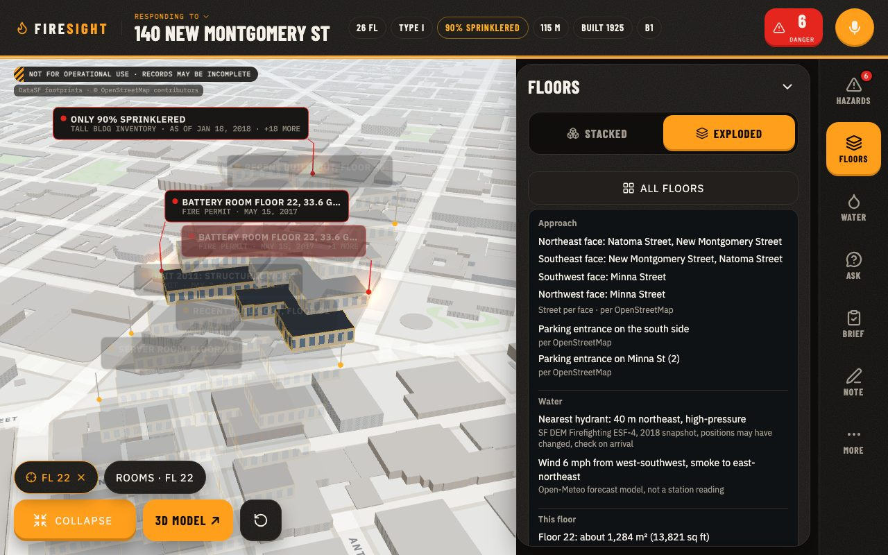

# FireSight

**An arrival brief for the fire officer on a responding engine, built only from cited San Francisco public records.**

From a dispatch line, typed or spoken, FireSight finds the building, opens the 3D tower at the fire floor, and tells the officer where the people are, what is on that floor, what to bring and check, how to reach the water, and what to verify on arrival. Every line cites its record.

**Try it:** https://firesight-ten.vercel.app (the story is the rig's tablet; the demo runs in a laptop browser, and AR needs Chrome on Android)

**Demo video:** _link coming_
<!-- VIDEO: replace with YouTube/Loom link + thumbnail docs/img/video-thumb.jpg -->



> **Not for operational use.** FireSight is an independent prototype built by a team of four in one day at a San Francisco hackathon. It is not affiliated with, endorsed by or reviewed by SFFD or any public agency. The dispatch line in the demo is simulated.

Built at super{set} SF, Oct 22 2026, for Track 1: Hacking with Public Data APIs.

## Why

A company officer often has a few minutes in the rig to size up a building they have never been inside. Much of what changes tactics is already public: construction type, height, battery rooms, open violations, past fires, the nearest hydrant. It is spread across dozens of city systems that nobody can search on the way to a call, and hand-built pre-plans take time and go stale.

In the fire service's own words (published quotes):

> "We definitely would have looked at things a lot different. If we had known that the roof structure in that building was of lightweight construction."
> Ed Smith, North Perth Fire Department, on the 2011 Listowel collapse that killed two firefighters. CTV News, Aug 19 2016.

> "The fire department had not conducted a formal pre-incident inspection of this facility nor developed a formal pre-incident plan."
> NIOSH Fire Fighter Fatality Investigation F2021-10, Spring Valley NY. Dec 2024.

## What the officer gets

Dispatch in: "Structure fire, 140 New Montgomery St, smoke reported 22nd floor". FireSight resolves the address across city records that file the same building under different addresses and names, then separates the tower's floors at the fire floor inside a 2.5 km city context. The arrival brief follows, life first:

1. **People.** Recorded counts relative to the fire floor and the floors above it. The office-code ceiling (floor area / 150 sq ft per person) is labelled as a ceiling, not a count.
2. **Fire floor.** What occupies the fire floor (by type, never by name), and hazards on it and one floor above and below.
3. **Bring and check.** Considerations named by their records: battery electrolyte, fuel on site, high-rise standpipe operations, elevator rescues, a changed layout. Considerations, never orders.
4. **Water and access.** The street on each face, entrances from OpenStreetMap, the nearest hydrants with distance and direction, and the wind forecast with where the smoke goes.
5. **Verify on arrival.** Stairs, standpipe and roof access. No public record has them, so FireSight lists them as checks and never draws them.

<!-- IMG 2: arrival brief beside the floor panel for floor 22. Save as docs/img/brief.jpg, then replace this comment with:  -->

**Voice.** The brief is spoken in a natural voice (ElevenLabs), and each sentence lights the floors it names. A spoken update such as "people trapped on floor 23" becomes a dispatch report: floor 23 lights up and FireSight reads what the records say about it. Hands-free intent through TypeSafe Jev (a typed decision with a confidence score, "Say again?" below a threshold, keyword fallback) is being integrated.

<!-- IMG 3: voice caption on screen while the brief is spoken, with the named floor lit. Save as docs/img/voice.jpg, then replace this comment with:  -->

**AR.** "View in AR" on Android puts the tower on the table. Pick a floor to see a glass info card, explode or assemble the floors, and open a schematic of the inside of floor 22 (no stairs drawn, because none are on record).

<!-- IMG 4: AR tower on a table (capture on an Android phone). Save as docs/img/ar.jpg, then replace this comment with:  -->

**Ask, approve, strike.** Claude Opus 5.5 answers questions and drafts the brief from the cited records only. The officer approves or strikes each line before it goes to the crew, and each struck line becomes a test case.

**Rules and provenance.** A compliance strip checks the rules that apply to the building (California Fire Code 1205 and 1207, SFFD's high-rise annual inspection, and a "maps to NFPA 1660" pre-plan coverage check). Every pin opens its source record.

## Example: 140 New Montgomery St

Parcel 3722/080, the 26-story tower the city's Tall Building Inventory calls the "Pac Bell Building". From the cached file [`web/public/buildings/sf-3722080.json`](web/public/buildings/sf-3722080.json), snapshot of Oct 22, 2026:

| Fact | Label | Source (dataset id) | As of |
|---|---|---|---|
| Height: 114.8 m (LiDAR median) vs 413 ft (Tall Building Inventory) | CONFLICT | Building footprints `ynuv-fyni`; Tall Building Inventory `5kya-mfst` | 2023 / 2018 |
| Type I fire resistive, 26 stories, 1 basement level | VERIFIED | Tax roll `wv5m-vpq2`; Tall Building Inventory `5kya-mfst` | 2025 / 2018 |
| 90 percent sprinklered | VERIFIED | Tall Building Inventory `5kya-mfst` | 2018 |
| Battery rooms on floors 22 and 23, 33.6 gallons each (STALE) | VERIFIED | SFFD fire permits `893e-xam6` | 2017 |
| Fire pump and diesel day tanks in basement B1 | VERIFIED | SFFD fire permits `893e-xam6` | 2016 |
| High-rise annual inspection completed | VERIFIED | SFFD inspections `wb4c-6hwj` | 2025-12-04 |
| High-pressure hydrant 40 m NE; low-pressure hydrant 40 m NNW; cistern 313 m ESE | VERIFIED | SF Dept. of Emergency Management, Firefighting ESF-4 | 2018 snapshot |
| Stair count and locations; standpipe and FDC locations | UNVERIFIABLE | No public floor plans | n/a |

The height conflict matters: 36 ft is about three stories at this building's typical 13 ft story. FireSight shows both numbers and lets the officer decide. Three more buildings are cached: 400 Duboce Ave (`sf-0874003`), 1018 Mission St (`sf-3703081`) and 1433 Haight St (`sf-1244030`).

## How it works

```
data.sf.gov + SF DEM ArcGIS + OSM + Open-Meteo   (88 public sources)
        |  scripts/fetch_sources.py, build_fixture.py
        |  GitHub Action re-pulls every 30 min, commits only on change
        v
Building JSON per parcel  (pins, conflicts, unknowns, per-source as-of dates, join log)
        |
        +--> web/  React + react-three-fiber: 3D explode, floor panel, brief, voice, AR
        +--> api/  Hono: brief and ask -> Claude Opus 5.5 -> citation validator
        |          -> officer approves or strikes; TTS via ElevenLabs; compliance
        +--> mcp/  read-only MCP server for other agents
```

- **Resolver.** Each dataset joins to the building by the strongest key it has: parcel block/lot or EAS address id (exact), a normalized address including ranges like "1018 - 1024 Mission St", or a spatial radius. Every join records its method, confidence and record count.
- **Fusion.** Records become pins. A floor named in a record ("floor 22 computer room") anchors the pin to that floor; the rest go to the building, roof or ground. When sources disagree, the pin is labelled CONFLICT and shows both values.
- **Brief.** The API sends the fused building to Claude Opus 5.5 with structured output. A validator drops any line that does not cite a pin in the building. If no API key is set or the call fails, the API serves the building's precomputed brief.
- **MCP.** Three read-only tools over stdio (`resolve_address`, `get_building_intel`, `get_size_up_brief`). It cannot change anything. See [`mcp/README.md`](mcp/README.md).

## Public data used

`scripts/fetch_sources.py` queries 88 public sources per building. The core ones:

| Source | Dataset id | Used for |
|---|---|---|
| DataSF Enterprise Addressing System | `3mea-di5p` | Address to parcel and EAS id |
| DataSF Assessor property tax roll | `wv5m-vpq2` | Construction, year built, stories, units, use |
| DataSF Building permits | `i98e-djp9` | Solar, alarm, sprinkler, structural work, floor numbers |
| DataSF SFFD fire permits | `893e-xam6` | Battery storage, tanks, assembly, hazmat |
| DataSF Fire incidents | `wr8u-xric` | Past fires and system malfunctions |
| DataSF Fire violations | `4zuq-2cbe` | Exits, alarm and sprinkler testing |
| DataSF Fire inspections | `wb4c-6hwj` | Inspection status |
| DataSF DBI notices of violation | `nbtm-fbw5` | Unsafe building and facade notices |
| DataSF DBI complaints | `gm2e-bten` | Open cases |
| DataSF Soft-story properties | `beah-shgi` | Soft-story status and retrofit |
| DataSF Building footprints | `ynuv-fyni` | Footprint and LiDAR height |
| DataSF Tall Building Inventory | `5kya-mfst` | Height, stories, sprinkler percentage, structure |
| DataSF Registered business locations | `g8m3-pdis` | What occupies the building, by type and count only |
| DataSF Calls for service | `nuek-vuh3` | Recent activity near the block |
| SF Dept. of Emergency Management, Firefighting ESF-4 (ArcGIS) | `Firefighting_ESF_4` layers | Hydrants, cisterns, fire stations |
| OpenStreetMap | Overpass API | Entrances, hydrant fallback |
| Open-Meteo | Forecast API | Wind and air quality |

DataSF datasets are PDDL (public domain), read from each dataset's metadata on Oct 22, 2026. The Tall Building Inventory and the ESF-4 layers state no license, so we cite source and date. OpenStreetMap data is ODbL, © OpenStreetMap contributors.

## Limits

- **No floor plans.** Stairs, standpipes, FDCs, roof access and layouts are not on public record. They are labelled UNVERIFIABLE and never drawn.
- **Counts are lower bounds.** Units, occupancy and permit-derived counts come from permit text and miss whatever was never permitted.
- **Business licenses are partial.** What occupies a floor is only as complete as the city's records.
- **Old records stay labelled.** Anything older than five years is marked STALE. Heights come from 2010 LiDAR, footprints from 2023, the Tall Building Inventory from 2018, hydrants from a 2018 snapshot.
- **Feeds lag.** City fire incident data runs about 4 weeks behind and calls for service about 8 hours. The refresh runs every 30 minutes but is only as fresh as the city publishes.
- **Wind is a forecast,** not a measurement at the building.
- **Four buildings, one city.** Only four San Francisco buildings are cached.
- **Records can be wrong.** The limits panel in the app says so on screen.

FireSight does not replace the officer's size-up, 360 or department pre-plan, predict fire behavior, or make tactical decisions.

## Trust and safety

Every fact carries one of three labels:

| Label | Meaning |
|---|---|
| **VERIFIED** | A public record says it. The pin shows which one. |
| **UNVERIFIABLE** | No public record covers it. |
| **CONFLICT** | Records disagree. FireSight shows both. |

- **Validator.** Any model line without a valid citation is dropped before the officer sees it. In the last saved eval ([`web/public/eval/last-run.json`](web/public/eval/last-run.json)), Claude Opus 5.5 wrote 48 brief lines across the four buildings (37 VERIFIED, 7 UNVERIFIABLE, 4 CONFLICT) and the validator dropped 0. It also answered 20 questions, with 0 dropped.
- **A human decides.** The officer approves or strikes every line. Struck lines become test cases.
- **Considerations, not orders.** The brief never tells a crew what to do.
- **No names.** Tenant and permit-holder names are stripped from permit text by an allowlist, and contact fields in city map layers are dropped. Occupants show by type only. Incidents show counts and types only.
- **Read-only to agents.** The MCP server cannot write or change anything.

## Run it locally

Needs Node 22 and Python 3.

```bash
# API (Hono): brief, ask, strike, compliance, speech
cd api && npm ci && cp .env.example .env && npm start
# In api/.env: ANTHROPIC_API_KEY (model-written brief), ELEVENLABS_API_KEY (spoken brief).
# TYPESAFE_API_KEY is optional (for the voice intent work in progress). Never commit the file.

# Web app (Vite + React + react-three-fiber)
cd web && npm ci && npm run dev

# Read-only MCP server in the MCP Inspector
cd mcp && npm ci && npm run inspect

# Re-pull every cached building from data.sf.gov once
python3 scripts/refresh.py --once

# Tests (citation validator, compliance rules, routes) and the eval
cd api && npm test && npm run eval
```

API routes: `POST /api/brief`, `POST /api/ask`, `POST /api/strike`, `POST /api/compliance`, `POST /api/tts`, `GET /api/health`. The building contract is in [`shared/building.ts`](shared/building.ts).

## Team

- Devaj ([@Devaj6190](https://github.com/Devaj6190)): 3D and deploy
- Rishit: data
- Rohan: shell and pitch
- Vidyut: AI, compliance and MCP

Built at super{set} SF, Oct 22 2026.

## Acknowledgements

DataSF and the City and County of San Francisco, SFFD's open data, the SF Department of Emergency Management, OpenStreetMap contributors and Open-Meteo publish the data. Bilawal Sidhu's God's Eye View and Ferhan Özkan's PICO XR demo inspired the 3D view. NIOSH's Fire Fighter Fatality Investigation program and CTV News are quoted above.

## License

No license file exists yet. The data sources keep their own licenses, listed above.
