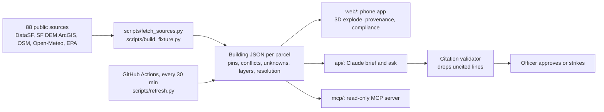

# FireSight

**Size-up starts before the wheels stop.**

FireSight turns a San Francisco address into a cited, floor-by-floor 3D pre-plan on a phone, for the officer on a responding engine.


Demo: TBD

> **Not for operational use.** FireSight is an independent prototype built by a team of four in one day at a San Francisco hackathon. It is not affiliated with, endorsed by or reviewed by SFFD or any public agency. The dispatch line in the demo is simulated. Your eyes, your 360 and your department's pre-plan come first.

## Why

A company officer often has a few minutes in the rig to size up a building they have never been inside. Much of what changes tactics is already public: construction type, height, battery rooms, open violations, past fires, the nearest hydrant. It is spread across dozens of city systems that nobody can search on the way to a call, and hand-built pre-plans take time and go stale.

In the fire service's own words (published quotes):

> "We definitely would have looked at things a lot different. If we had known that the roof structure in that building was of lightweight construction."
> Ed Smith, North Perth Fire Department, on the 2011 Listowel collapse that killed two firefighters. CTV News, Aug 19 2016.

> "The fire department had not conducted a formal pre-incident inspection of this facility nor developed a formal pre-incident plan."
> NIOSH Fire Fighter Fatality Investigation F2021-10, Spring Valley NY. Dec 2024.

## What it does

1. **Dispatch line in.** "Structure fire, 140 New Montgomery St, smoke reported 22nd floor." FireSight finds the building, even when city records file it under different addresses or names.
2. **Building in 3D.** The real footprint and measured height, split into floors. The floors separate, and the floor named in the dispatch line comes into focus.
3. **Facts pinned in place.** Each fact sits on its floor, the roof or the ground around the building. Tap one for its provenance card: dataset id, record id, as-of date and the rule that placed it. Records older than 5 years carry a **STALE** badge.
4. **Disagreements and gaps said out loud.** When two city records disagree, FireSight shows both. Stairs, standpipes and anything with no public record show as unverifiable. FireSight does not guess.
5. **Rules checked, with citations.** A compliance strip shows pass, fail or unknown for the rules that apply to this building, and hides the ones that don't.
6. **Officer approves.** Claude drafts a short size-up from the cited facts only. The officer approves or strikes each line before it goes to the crew, and each struck line becomes a test case.

Every fact carries one of three labels:

| Label | Meaning |
|---|---|
| **VERIFIED** | A public record says it. The pin shows which one. |
| **UNVERIFIABLE** | No public record covers it. |
| **CONFLICT** | Records disagree. FireSight shows both. |

## Example: 140 New Montgomery St

Parcel 3722/080, the 26-story tower the city's Tall Building Inventory calls the "Pac Bell Building". From the cached file [`web/public/buildings/sf-3722080.json`](web/public/buildings/sf-3722080.json), snapshot of Oct 22, 2026:

| Fact | Label | Source (dataset id) | As of |
|---|---|---|---|
| Height: 114.8 m (LiDAR median) vs 413 ft (Tall Building Inventory) | CONFLICT | Building footprints `ynuv-fyni`; Tall Building Inventory `5kya-mfst` | 2023 / 2018 |
| Type I fire resistive, 26 stories, 1 basement level | VERIFIED | Tax roll `wv5m-vpq2`; Tall Building Inventory `5kya-mfst` | 2025 / 2018 |
| 90 percent sprinklered | VERIFIED | Tall Building Inventory `5kya-mfst` | 2018 |
| Battery rooms on floors 22 and 23, 33.6 gallons each (STALE) | VERIFIED | SFFD fire permits `893e-xam6` | 2017 |
| Fire pump and diesel day tanks in basement B1 | VERIFIED | SFFD fire permits `893e-xam6` | 2016 |
| Server room on floor 18 | VERIFIED | Building permits `i98e-djp9` | 2022 |
| High-rise annual inspection completed | VERIFIED | SFFD inspections `wb4c-6hwj` | 2025-12-04 |
| 41 fire violations on record, 0 open | VERIFIED | Fire violations `4zuq-2cbe` | 2021 |
| Hydrant 40 m NNW; cistern 313 m ESE | VERIFIED | SF Dept. of Emergency Management, Firefighting ESF-4 | 2018 snapshot |
| Stair count and locations; standpipe and FDC locations | UNVERIFIABLE | No public floor plans | n/a |

The height conflict matters: 36 ft is about three stories at this building's typical 13 ft story. FireSight shows both numbers and lets the officer decide.

Three more buildings are cached: 400 Duboce Ave (`sf-0874003`), 1018 Mission St (`sf-3703081`) and 1433 Haight St (`sf-1244030`).

## How it works



**Resolver.** Each dataset joins to the building by the strongest key it has: parcel block/lot or EAS address id (exact), a normalized address including ranges like "1018 - 1024 Mission St", or a spatial radius. Every join records its method, its confidence and how many records matched. The resolution view shows this per dataset.

**Fusion.** Records become pins. A floor named in a record ("floor 22 computer room", "unit 311") anchors the pin to that floor; anything without a floor goes to the building, roof or ground. When sources disagree, the pin is labelled CONFLICT and shows both values.

**Refresh.** [`.github/workflows/refresh.yml`](.github/workflows/refresh.yml) re-pulls every cached building from data.sf.gov every 30 minutes and commits only when something changed. Each source is as fresh as the city publishes it. The sources drawer shows each source's as-of date and the refresh log.

**Brief.** The API sends the fused building to Claude Opus 5.5 with structured output. A validator drops any line that does not cite a pin in the building. If no API key is set or the call fails, the API serves the building's precomputed brief and answers when the file carries them (`npm run precompute` fills them).

**MCP.** A read-only Model Context Protocol server over stdio lets other agents ask for a building's intel and get typed, cited answers. It cannot change anything.

## Code checks, with citations

The compliance strip ([`shared/compliance.ts`](shared/compliance.ts)) shows pass, fail or unknown, each with its citation. For 140 New Montgomery it shows:

- **C7 High-rise annual inspection.** SFFD's high-rise annual inspection program and the 75 ft high-rise rule. The last one on record was completed 2025-12-04.
- **C3 Open fire code violations.** 41 on record, 0 open.
- **C5 Battery storage, California Fire Code 1207.** The permit lists gallons of electrolyte, not kWh, so whether 1207 applies shows as unknown.
- **C8 Pre-plan elements.** The brief **maps to NFPA 1660** pre-incident planning elements, using the NFPA 1620 element text that 1660 absorbed. This is coverage, not a compliance claim.

Two more rules appear when they apply:

- **C1 Annual fire inspection, California Health and Safety Code 13146.2.** For apartments and hotels, a building **meets** this check when SFFD's inspection data shows one within the last year (matching SFFD's inspection type to the statute is our reading). Hidden for an office tower like 140 New Montgomery.
- **C4 Rooftop solar access pathways, California Fire Code 1205.** Shown only when a solar permit is on record. FireSight's rule logic for which pathway requirement fits the building **meets** 1205. Roof layouts are not public, so whether the pathways exist shows as unknown.

## Data limits

- Building heights come from 2010 LiDAR scans; footprints are from September 2023.
- The Tall Building Inventory was collected in 2018.
- Hydrant and cistern positions are from a 2018 SF Dept. of Emergency Management snapshot.
- City fire incident data runs about 4 weeks behind, and calls for service about 8 hours.
- Units and occupancy come from permit text, so treat them as lower bounds.
- There are no public floor plans, so stairs, standpipes and layouts are UNVERIFIABLE. FireSight never draws an interior.
- The battery storage permit lists gallons, not kWh.
- Public records can be wrong or out of date. The limits panel in the app says this on screen.

**It doesn't** replace your size-up, your 360 or your department's pre-plan, predict fire behavior, make tactical decisions, send anything to a crew without an officer approving it, or cover anywhere but San Francisco.

## Responsible data

- **No personal information.** Some city map layers include building managers' names, phones and emails. FireSight drops those fields, and it shows no tenant or permit-holder names. Incidents show counts and types only.
- **Every pin is traceable.** Dataset id, record id and as-of date, plus the rule that placed it.
- **A human decides.** The officer approves or strikes every line of the brief.
- **Read-only to agents.** The MCP server cannot write or change anything.
- **No guessing.** Missing facts are labelled UNVERIFIABLE, not filled in.

## Quick start

Needs Node 22 and Python 3.

```bash
# Phone app (Vite + React + react-three-fiber)
cd web && npm ci && npm run dev

# API (Hono): brief, ask, strike, compliance
cd api && npm ci && cp .env.example .env && npm run dev
# Add your own ANTHROPIC_API_KEY to api/.env for the model-written brief. Never commit it.

# Read-only MCP server, opened in the MCP Inspector
cd mcp && npm ci && npm run inspect

# Re-pull every cached building from data.sf.gov once
python3 scripts/refresh.py --once

# Tests (citation validator, compliance rules, routes)
cd api && npm test
```

**API routes:** `POST /api/brief`, `POST /api/ask`, `POST /api/strike`, `POST /api/compliance`, `GET /api/health`.

**MCP tools:** `resolve_address`, `get_building_intel`, `get_size_up_brief`. See [`mcp/README.md`](mcp/README.md).

## The Building JSON contract

One file per building, keyed by parcel (for example `sf-3722080`). The full types are in [`shared/building.ts`](shared/building.ts).

| Field | What it holds |
|---|---|
| `footprint`, `heightM`, `floors`, `floorHeightM` | Geometry in local meters |
| `pins[]` | Every fact on the model: `severity`, `anchor` (building, floor, roof or ground), `label`, `claim`, `evidence[]`, `stale` |
| `conflicts[]` | Records that disagree, with a one-line summary |
| `unknowns[]` | Facts with no public record |
| `layers[]` | Per source: `ok`, `no_records` or `fetch_failed`, with an as-of date |
| `resolution` | Parcel, EAS id, address aliases, and every join with method, confidence and record count |
| `fallback` | Precomputed brief and answers for when the network is slow or gone |

## Repo layout

```
web/                    Phone app: 3D scene, explode, provenance, panels, brief sheet, eval screen
web/public/buildings/   Building JSON per cached building (sf-<parcel>.json)
api/                    Hono API: Claude brief and ask, citation validator, strike, compliance
mcp/                    Read-only stdio MCP server
shared/                 Contract, compliance rules, API client, dispatch parsing, conflicts
scripts/                fetch_sources.py, build_fixture.py, refresh.py
.github/workflows/      refresh.yml (every 30 minutes)
docs/handoff/           Setup, deploy, refresh and per-lane notes
docs/plan/              Build plan, data and regulation research
```

## Status

**Working (on main)**
- Phone app: dispatch line, explode, floor focus, provenance cards with STALE badges, resolution view with the height CONFLICT, limits panel, sources drawer, compliance strip, brief sheet with approve and strike, eval screen.
- API with Claude Opus 5.5 structured output and a citation validator, plus tests.
- Read-only MCP server with three tools.
- Source fetch and fixture build across 88 public sources; four cached buildings.
- Refresh job every 30 minutes that commits only on change.

**Not yet**
- Public deploy (Demo: TBD).
- Published eval results; the eval screen reads them once a run is saved.
- Precomputed fallback answers in the cached building files.
- Tabletop AR, neighboring buildings (exposures), and coverage beyond four buildings.
- A license for the code.

## Data sources and licenses

`scripts/fetch_sources.py` queries 88 public sources per building. The core ones:

| Source | Dataset id | Used for | License |
|---|---|---|---|
| DataSF Enterprise Addressing System | `3mea-di5p` | Address to parcel and EAS id | PDDL (public domain) |
| DataSF Assessor property tax roll | `wv5m-vpq2` | Construction, year built, stories, units, use | PDDL |
| DataSF Building permits | `i98e-djp9` | Solar, alarm, sprinkler, structural work, floor and unit numbers | PDDL |
| DataSF SFFD fire permits | `893e-xam6` | Battery storage, tanks, assembly, hazmat | PDDL |
| DataSF Fire incidents | `wr8u-xric` | Past fires and system malfunctions | PDDL |
| DataSF Fire violations | `4zuq-2cbe` | Exits, alarm and sprinkler testing | PDDL |
| DataSF Fire inspections | `wb4c-6hwj` | Inspection status | PDDL |
| DataSF DBI notices of violation | `nbtm-fbw5` | Unsafe building and facade notices | PDDL |
| DataSF DBI complaints | `gm2e-bten` | Open cases | PDDL |
| DataSF Soft-story properties | `beah-shgi` | Soft-story status and retrofit | PDDL |
| DataSF Building footprints | `ynuv-fyni` | Footprint and LiDAR height | PDDL |
| DataSF Tall Building Inventory | `5kya-mfst` | Height, stories, sprinkler percentage, structure | Not checked; we cite source and date |
| DataSF Calls for service | `nuek-vuh3` | Recent activity near the block | PDDL |
| SF Dept. of Emergency Management, Firefighting ESF-4 (ArcGIS) | `Firefighting_ESF_4` layers | Hydrants, cisterns, fire stations | No license stated; we cite source and date |
| OpenStreetMap | Overpass API | Hydrant fallback | ODbL, © OpenStreetMap contributors |
| Open-Meteo | Forecast API | Wind and air quality | Open-Meteo terms |

DataSF licenses were read from each dataset's metadata on Oct 22, 2026. Attribution shown in the app: "Building data: DataSF", "© OpenStreetMap contributors", "Weather: Open-Meteo".

## Team

Built at the super{set} national renaissance hackathon, San Francisco, Oct 22, 2026 (Track 1: Hacking with Public Data APIs) by:

- Devaj ([@Devaj6190](https://github.com/Devaj6190)): 3D and deploy
- Rishit: data
- Rohan: phone shell and pitch
- Vidyut: AI, compliance and MCP

## Acknowledgements

- **Data publishers:** DataSF and the City and County of San Francisco, the San Francisco Fire Department's open data, the SF Department of Emergency Management, OpenStreetMap contributors, and Open-Meteo.
- **Inspiration:** Bilawal Sidhu's God's Eye View and Ferhan Özkan's PICO XR demo.
- **Published voices:** NIOSH's Fire Fighter Fatality Investigation program and CTV News, quoted above.

## License

No license file exists yet. The data sources keep their own licenses, listed above.
